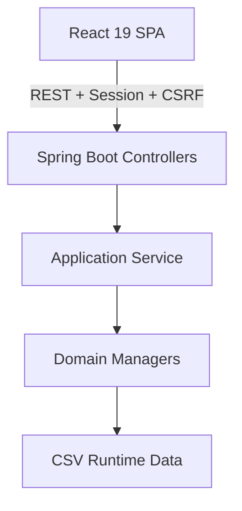
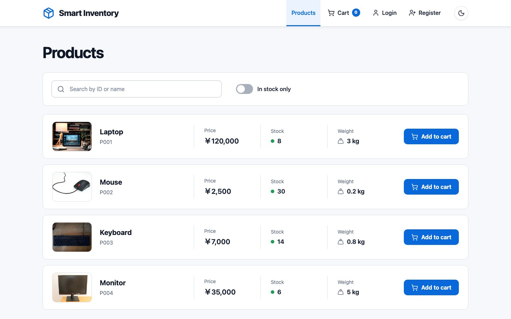
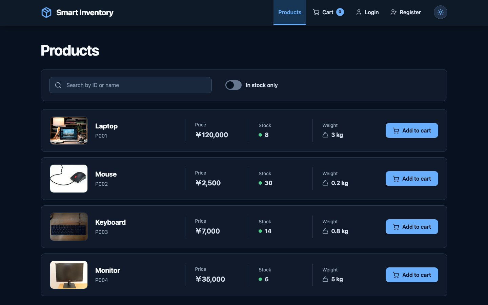
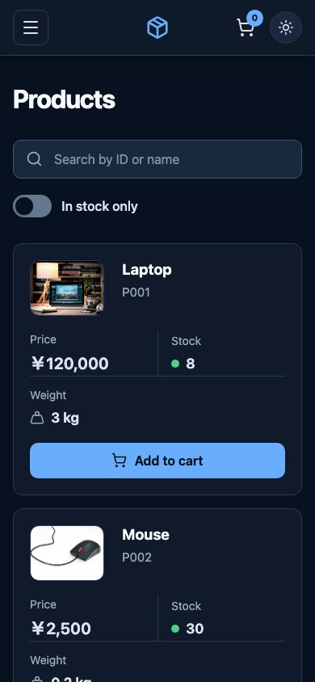
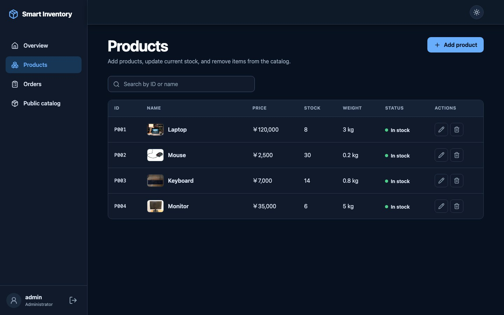
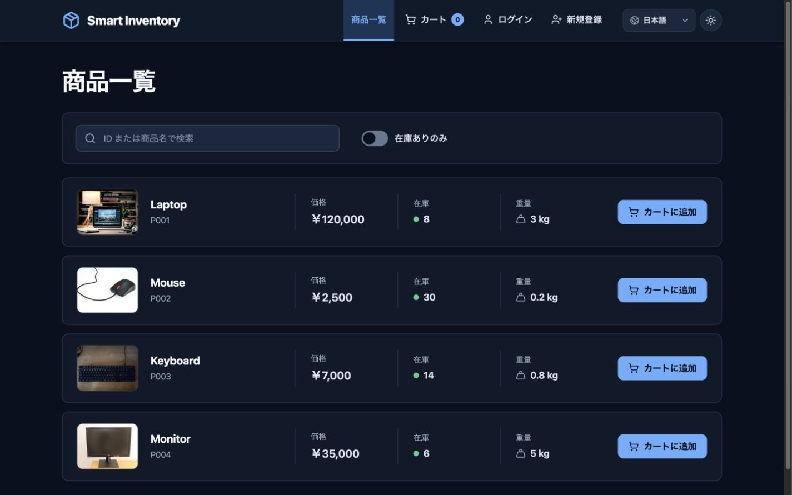
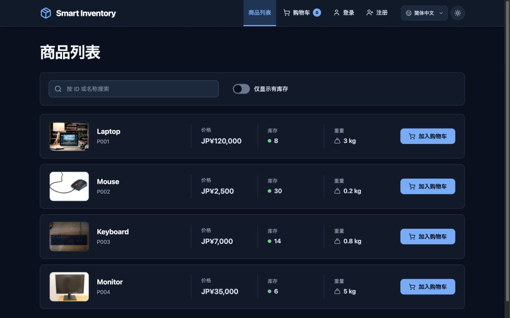
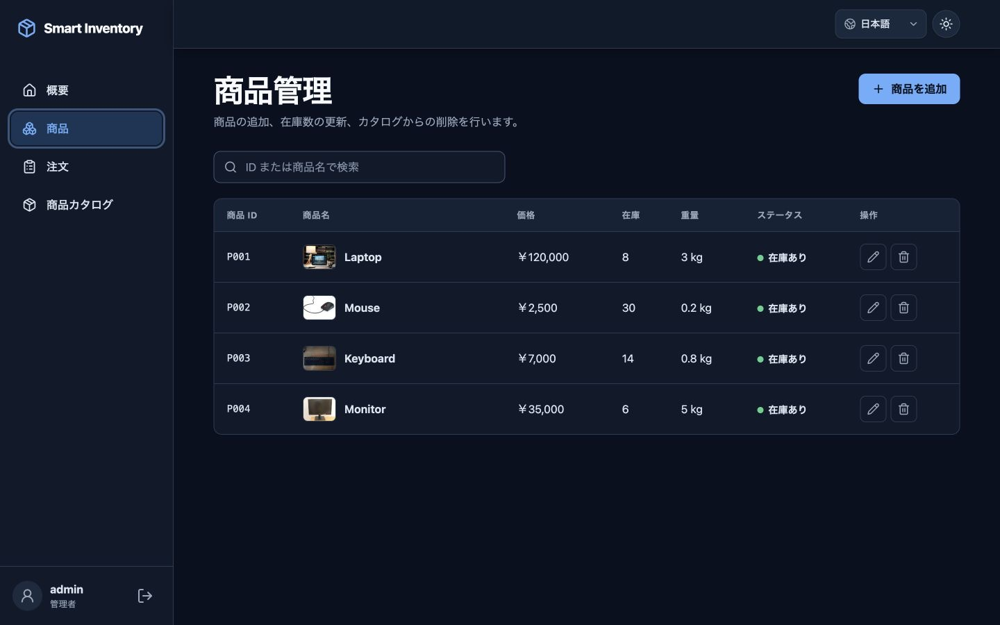
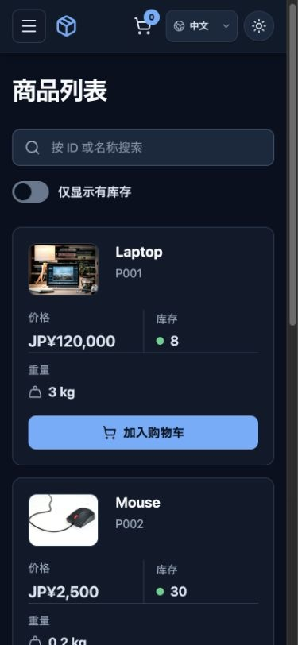

# Smart Inventory

日本語 | [English](README.en.md)

Smart Inventory は、商品・在庫・顧客注文・梱包数の見積もりを管理する、授業課題・ポートフォリオ向けのフルスタックデモです。元の Java オブジェクト指向プログラミング課題の業務ルールとソースコードを残しながら、React のシングルページアプリケーションと、Spring Boot REST API またはオプションの Rust API を組み合わせています。

標準の Java 版には、次の2つの実行方法があります。

- **開発環境：** `http://localhost:5173` の Vite が、`/api` リクエストを `http://localhost:8080` の Spring Boot にプロキシします。
- **配布用デモ：** React のビルド結果を1つの実行可能な Spring Boot JAR に組み込み、`http://localhost:8080` で配信します。

追加の [Rust バックエンド](backend-rust/README.md) は、React の画面を変更せずに、同じ `/api` 契約と CSV 形式に対応します。Rust 版には開発・テスト・ネイティブパッケージ作成用の専用コマンドがあります。Rust を選んでも、Java の授業課題を置き換えたり削除したりすることはありません。

## オンラインデモ

- 入口（GitHub Pages）：[https://kai987.github.io/Smart_Inventory_Java_Project/](https://kai987.github.io/Smart_Inventory_Java_Project/)
- Site へ直接アクセス：[https://smart-inventory-demo.huamengdiqidiguo.chatgpt.site/products](https://smart-inventory-demo.huamengdiqidiguo.chatgpt.site/products)

オンライン版は React の画面と **TypeScript/Vinext API＋D1 データベース**で構成します。Rust 版はローカル開発・実行用として残し、この Site にはデプロイしません。GitHub Pages は Site へのリダイレクト専用で、Java・Rust のサーバーやデータベースを実行する場所ではありません。

公開デモアカウントでは、顧客の注文や管理者の商品・在庫変更が可能です。共有デモデータは他の利用者によって変更されることがあります。実際の決済は行いません。実在する個人情報・実顧客データ・他サービスで使っているパスワードは入力しないでください。認証情報は後述の「デモアカウント」を参照してください。

## コンソール版からフルスタックアプリケーションへ

最初のバージョンは、オブジェクト指向プログラミングの授業で作成した Java コンソールアプリケーションです。そのソースコード・CSV データ・ドキュメント・回帰テストは、履歴を残すために [`legacy-console/`](legacy-console/README.md) に保存しています。Web 版では、業務ルールを Java 21 のバックエンドに移し、並行アクセスを安全に扱うアプリケーションサービス、REST API、レスポンシブな React UI を追加しています。

コンソール版と Web 版の実行時データは共有しません。

## 主な機能

- ログイン不要の商品検索。商品 ID・商品名の部分一致と、大文字・小文字を区別しない検索に対応
- 顧客登録とセッションベースのログイン
- `CUSTOMER`・`ADMIN` の権限に応じたナビゲーションとアクセス制御
- 顧客用カート、注文作成、注文履歴、円建て合計金額、合計重量、10 kg 単位の箱数見積もり
- 在庫の一括検証。同じ商品の重複行を合算し、1商品でも在庫が不足すれば、在庫を変更せず注文全体を拒否
- アカウント単位の非公開クエリキャッシュと、認証ユーザー変更時のリクエスト中断
- 永続化された顧客単位の送信キーによる安全な注文再送。成功時は送信した数量だけをカートから差し引く
- 管理者ダッシュボード、商品追加、在庫更新、商品削除、注文確認
- 商品が変更・削除された後も参照できる、注文時の商品情報のスナップショット
- アクセシビリティに配慮したライト／ダークテーマ。初回は OS の設定に従い、利用者が選んだテーマを保存
- 英語・日本語・簡体字中国語の UI。言語の自動判定と、右側に常設された言語選択に対応
- 最適化した商品写真のローカル配信。商品一覧・カート・注文・管理画面で共通の読み込み・代替表示を利用
- 初期データ、旧形式からの移行、不正データ検出時の起動中止、保存失敗時のロールバック、ロック制御に対応した UTF-8 CSV 保存
- 入力検証・認証・認可・業務処理・永続化エラーに対する一貫した JSON エラー応答
- バックエンドテスト、フロントエンド単体テスト、ブラウザ E2E テスト
- フロントエンドとバックエンドを1つの実行可能 JAR にまとめるビルド
- 同じ UI・API 契約を保ち、D1 にデータを保存する Sites 向けデプロイ構成

## アーキテクチャ



コントローラーは HTTP リクエストと DTO の変換を担当します。`SmartInventoryService` は共有アプリケーション状態と読み書きロックを管理し、ドメインマネージャーの呼び出しと永続化の境界を調整します。ドメインオブジェクトは、在庫・価格・注文・スナップショット・梱包数の計算を担当します。`CsvFileManager` は、CSV の実装詳細を API に露出させずにデータを読み書きします。

## 技術スタック

| レイヤー | 技術 |
| --- | --- |
| バックエンド | Java 21、Spring Boot 3.5.16、Spring MVC、Spring Security、Jakarta Bean Validation、Maven Wrapper |
| バックエンドテスト | JUnit 5、MockMvc、Spring Security Test |
| オプションの Rust バックエンド | Rust 1.93 以降、Axum、Tokio、bcrypt、Cargo によるテスト |
| フロントエンド | React 19、TypeScript strict モード、Vite、React Router、TanStack Query v5、i18next |
| フォーム・HTTP | React Hook Form、Zod、Axios |
| UI | CSS Modules、Lucide React |
| フロントエンドテスト | Vitest、React Testing Library、Playwright |
| データ保存 | ローカルディスク上の UTF-8 CSV ファイル |
| 自動化 | Bash スクリプト、GitHub Actions |

## リポジトリ構成

```text
.
├── backend/                 Spring Boot API、ドメイン、永続化処理、テスト
├── backend-rust/            API 互換のオプション Rust バックエンドとテスト
├── frontend/                React/Vite SPA、単体テスト、Playwright テスト
├── site/                    D1 API を備えた Sites/Vinext 向け構成
├── pages/                   オンライン Site へ移動する GitHub Pages 用の入口
├── legacy-console/          元の OOP 授業課題のコンソールアプリケーション
├── runtime-data/            Java Web 版の実行時 CSV。自動生成され、Git 管理対象外
├── runtime-data-rust/       Rust 版専用の実行時 CSV。自動生成され、Git 管理対象外
├── scripts/                 開発・テスト・ビルド・データ初期化用スクリプト
├── .github/workflows/       CI
├── docs/design-reference/   初期デザイン案。実行画面のスクリーンショットではない
├── docs/screenshots/        実行可能 JAR で確認した画面のスクリーンショット
├── docs/THIRD_PARTY_ASSETS.md  商品画像の出典・ライセンス・加工内容
├── README.md                日本語版 README（既定）
├── README.en.md             英語版 README
└── LICENSE
```

## 必要な環境

- Java Development Kit 21
- Node.js 24 と npm
- macOS または Linux の Bash
- E2E テスト用の Playwright Chromium
- Rust 版を使う場合のみ、Rust 1.93 以降と Cargo・rustfmt・Clippy。Rust 版のビルド・実行には Java は不要

必要な Maven は Maven Wrapper が自動的にダウンロードするため、Maven のグローバルインストールは不要です。

主なツールのバージョンを確認します。

```bash
java -version
node -v
npm -v
```

## 開発環境のクイックスタート

リポジトリのルートから実行します。

```bash
npm --prefix frontend ci
./scripts/dev.sh
```

[http://localhost:5173](http://localhost:5173) を開きます。`Ctrl+C` を1回押すと、Vite と Spring Boot の両方を停止します。スクリプトはリポジトリを基準にパスを解決するため、別のディレクトリから呼び出すこともできます。

開発時の標準ポートは次のとおりです。

| プロセス | URL |
| --- | --- |
| React/Vite | `http://localhost:5173` |
| Spring Boot API | `http://localhost:8080/api` |

Vite が Spring Boot にプロキシするのは `/api` だけです。フロントエンドはバックエンドのオリジンをハードコードせず、相対 URL の `/api` を使用します。

### 実行時の設定

| 設定内容 | 設定キー | 既定値 |
| --- | --- | --- |
| CSV データディレクトリ | `SMART_INVENTORY_DATA_DIR` | `./runtime-data` |
| CORS で許可するオリジン | `SMART_INVENTORY_ALLOWED_ORIGINS` | `http://localhost:5173` |
| 在庫僅少と判定するしきい値 | `app.low-stock-threshold` | `5` |
| セッション Cookie の Secure 属性 | `SMART_INVENTORY_SECURE_COOKIE` | `false` |

`scripts/dev.sh` は、環境変数が設定されていなければ `SMART_INVENTORY_DATA_DIR` をリポジトリ直下の `runtime-data/` に設定します。認証情報付き CORS では、許可するオリジンを明示してください。`*` は使用できません。

### オプションの Rust バックエンド

リポジトリのルートから実行します。

```bash
npm --prefix frontend ci
./scripts/dev-rust.sh
```

[http://localhost:5173](http://localhost:5173) を開きます。同じフロントエンドと、8080 番ポートの Rust バックエンドが起動します。`Ctrl+C` で両方を停止します。Java 版と Rust 版は同じポートを使うため、開発サーバーを同時に起動しないでください。Rust 版の既定の保存先は `runtime-data-rust/` で、Java 版の `runtime-data/` は変更しません。

検証とネイティブデモパッケージの作成は、次のコマンドで行います。

```bash
./scripts/test-rust.sh
SMART_INVENTORY_BACKEND=rust npm --prefix frontend run test:e2e
./scripts/build-rust-demo.sh
./backend-rust/dist/run.sh
```

ビルドコマンドは、ブラウザを使わない検証も実行します。E2E テストを実行する前に、後述の手順で Chromium をインストールしてください。生成されるのは JAR ではなく、ネイティブ実行ファイルと `public/` を含むパッケージです。対応する OS・CPU では Java・Node.js なしで実行できます。配布時はパッケージのフォルダー全体を渡してください。既存データを再利用する前に、[Rust のセットアップ・設定・安全な CSV 移行](backend-rust/README.md)を確認してください。

Rust 版は専用の `RUSTSESSIONID` Cookie を使うため、バックエンドを切り替えた後は再ログインが必要です。Java 版・Rust 版ともにサーバー側セッションと CSRF 保護を使用します。独立してデプロイする `site/` は TypeScript/Vinext と D1 を使用しており、Rust バックエンドを導入しただけでは置き換えられません。

### 認証と注文処理の境界

登録用パスワードは4～100文字で、かつ BCrypt の上限である UTF-8 の72バイト以内である必要があります。フォームと Java・Rust・Site の各 API は、上限を超える値を切り詰めずに拒否します。日本語・中国語などの文字は、1文字に複数バイトを使うことがあります。

顧客・管理者のクエリキーには、確認済みのアカウント情報を含めます。ログイン・ログアウト・確認済みのセッション失効時には、非公開データへのリクエストを中断し、以前のアカウントのキャッシュを削除します。遅れて完了した注文処理や管理者操作のコールバックが、別のアカウントの現在の UI に変更を加えないようにしています。

注文処理中はカートの編集操作を無効にします。注文時に `Idempotency-Key` を送信し、同じ内容の再送では、ページ再読み込み後も同じキーを使います。3つのバックエンドは、ASCII 英数字・`_`・`-` からなる16～128文字の任意のキーを受け付けます。受理したキーは顧客単位で扱い、既存の永続化された注文 ID に組み込みます。そのため、重複行を合算した商品別数量が同じ再送では、サーバー再起動後や商品削除後でも元の注文を返し、在庫を再度減らしません。同じキーを異なる数量で使うと HTTP 409（`IDEMPOTENCY_CONFLICT`）を返します。キーを指定しないリクエストは、従来どおり受理するたびに新しい注文を作成します。

注文成功時は、送信時のスナップショットに含まれる数量だけをカートから差し引きます。これにより、リクエストの処理中に別の画面で追加した商品を残せます。応答を受け取れなかった場合は、受理済み注文によって在庫がゼロになっていても、元のキーで再送できます。ローカル CSV 版は、引き続き1つのデータディレクトリに対して1つの書き込みプロセスだけを想定します。冪等性への対応は、CSV を複数インスタンス対応のデータベースに変えるものではありません。

## 配布用ビルド

lint・テスト・フロントエンドビルド・バックエンドのパッケージ作成をまとめて実行します。

```bash
./scripts/build-demo.sh
```

次のファイルが生成されます。

```text
backend/target/smart-inventory-demo.jar
```

生成されたフロントエンドファイルはビルド出力内に配置されます。`backend/src/main/resources/static` にコピーしたり、Git にコミットしたりしません。

## 単一 JAR の実行

既定のデータディレクトリを `runtime-data/` にするため、リポジトリのルートから実行します。

```bash
java -jar backend/target/smart-inventory-demo.jar
```

[http://localhost:8080/products](http://localhost:8080/products) を開きます。`/cart`・`/orders`・`/admin`・`/admin/products` などのクライアント側ルートは、再読み込み時に `index.html` へ転送されます。不明な `/api/**` パスは React の画面ではなく、JSON の404エラーを返します。

データの保存先を明示する場合は、次のように設定します。

```bash
SMART_INVENTORY_DATA_DIR=/absolute/path/to/data \
  java -jar backend/target/smart-inventory-demo.jar
```

HTTPS で公開する場合は、`SMART_INVENTORY_SECURE_COOKIE=true` に設定し、セッション Cookie に Secure 属性を付けてください。

## デモアカウント

### 管理者

```text
username: admin
password: admin123
```

### 顧客

```text
username: customer
password: user123
```

これらはローカル版と公開オンライン版で使用するデモ用の認証情報です。本番用アカウントとして使用しないでください。初期データのパスワードは平文ではなく、計算コストを調整できるパスワードハッシュとして保存しています。

## デモデータの初期化

**この操作は Java Web 版のローカル実行時データを削除します。必要なデータを事前にバックアップしてください。** アプリケーションを停止してから実行します。

```bash
./scripts/reset-demo-data.sh
```

安全のため、このスクリプトはパス引数を受け付けず、リポジトリ直下の、シンボリックリンクではない `runtime-data/` だけを削除します。Rust 版や D1 のデータは削除しません。次の起動時に、不足する CSV ファイルをパッケージ内の初期データからコピーします。初期データによって、既存の実行時ファイルを通知なく上書きすることはありません。

## テスト

### バックエンド・フロントエンドの一括検証

```bash
./scripts/test.sh
```

バックエンドテスト、固定されたフロントエンド依存パッケージのインストール、フロントエンドの lint・単体テスト・配布用ビルド、共有 UI の一致確認、画面上の未翻訳文字列の検出を実行します。

### バックエンドテスト

```bash
(cd backend && ./mvnw test)
```

JUnit・MockMvc のテストでは、既存の業務ルール、CSV 互換性と異常時の動作、認証・CSRF、権限制御、API 契約、アプリケーションサービスのロールバックを検証します。

### フロントエンドテスト

```bash
npm --prefix frontend ci
npm --prefix frontend run lint
npm --prefix frontend run test -- --run
npm --prefix frontend run build
```

Vitest と React Testing Library で、利用者に見える状態や操作を検証します。配布用ビルド時には、TypeScript の strict モードで型チェックも行います。

### E2E テスト

最初に Playwright 用のブラウザをインストールし、その後 E2E テストを実行します。

```bash
(cd frontend && npm exec -- playwright install chromium)
npm --prefix frontend run test:e2e
```

Playwright の設定が必要なアプリケーションプロセスを起動し、分離されたテストデータを使用します。開発用の `runtime-data/` は変更しません。

Rust 版にも、`SMART_INVENTORY_BACKEND=rust npm --prefix frontend run test:e2e` で同じテストを実行できます。Rust 版のテストデータは `frontend/.playwright-data-rust/`、Java 版は `frontend/.playwright-data/` に分離されます。テスト実行前に、8080 番・5173 番ポートを空けてください。

### Sites 向け構成の検証

公開用の Site は同じ React 画面と REST 契約を使い、ローカルの Spring Boot プロセス・CSV ファイルの代わりに、Cloudflare Worker 対応 API と D1 データベースを使用します。

```bash
(cd site && npx --yes npm@11.6.2 ci)
npm --prefix site run test
npm --prefix site run lint
npm --prefix site run build
```

Site のローカルプレビューを起動します。

```bash
npm --prefix site run dev
```

[http://localhost:3000/products](http://localhost:3000/products) を開きます。Site のデータベースは、`runtime-data/`・`legacy-console/data/` のどちらとも独立しています。

## API 一覧

すべてのエンドポイントは `/api` 配下で JSON を使用します。円の金額は、JavaScript で整数精度を失わないよう、API では10進数の文字列として扱います。フロントエンドは表示・計算時に `BigInt` へ変換します。

| メソッド | エンドポイント | 必要な権限・条件 | 用途 |
| --- | --- | --- | --- |
| `GET` | `/api/auth/csrf` | 公開 | CSRF トークンとヘッダー名の取得 |
| `POST` | `/api/auth/register` | 公開・CSRF 必須 | `CUSTOMER` アカウントの登録 |
| `POST` | `/api/auth/login` | 公開・CSRF 必須 | 認証とセッションの作成 |
| `GET` | `/api/auth/me` | 認証済み | 現在のユーザーと権限の取得 |
| `POST` | `/api/auth/logout` | 認証済み・CSRF 必須 | 現在のセッションの無効化 |
| `GET` | `/api/products` | 公開 | 商品一覧・検索。`q`・`inStockOnly` に対応 |
| `GET` | `/api/products/{id}` | 公開 | 1商品の取得 |
| `POST` | `/api/products` | 管理者・CSRF 必須 | 商品の追加 |
| `PATCH` | `/api/products/{id}/stock` | 管理者・CSRF 必須 | 現在の在庫数量の設定 |
| `DELETE` | `/api/products/{id}` | 管理者・CSRF 必須 | 注文履歴を損なわない商品の削除 |
| `POST` | `/api/orders` | 顧客・CSRF 必須 | 現在の在庫に対する注文の作成 |
| `GET` | `/api/orders/me` | 顧客 | 現在の顧客自身の注文の取得 |
| `GET` | `/api/orders` | 管理者 | 全注文の取得、または顧客による絞り込み |
| `GET` | `/api/admin/summary` | 管理者 | 在庫・注文ダッシュボード集計の取得 |

登録 API は権限の指定を受け付けません。注文の顧客名は、必ず認証済みセッションから取得します。商品名・価格・重量・合計・梱包数は、カートのリクエストをそのまま信用せず、サーバー側で計算または読み込みを行います。

## CSV 永続化の設計

パッケージに含める初期データは `backend/src/main/resources/seed-data/` にあります。初回起動時に、不足するファイルを `runtime-data/` へコピーし、既存ファイルは保持します。読み込みは全件成功を条件とします。読み取り不能、不正な行、不正な値、重複 ID があれば起動を中止し、不完全な状態で動作したり、利用者のデータを上書きしたりしません。

ローダーは元のコンソール版の形式も受け付けます。たとえば `.0` を伴う整数価格、`P001:2` のような旧注文明細、`P001:Laptop:120000:3.0:2` のようなスナップショット明細です。その後の保存では、現在のスナップショット形式を使います。

並行する参照処理には読み取りロックを使います。登録・在庫変更・注文作成には書き込みロックを使います。注文処理全体、すなわち重複商品の合算、全商品の在庫検証、スナップショット作成、在庫削減、注文追加、両ファイルの保存を1つの書き込みロック内で実行します。永続化に失敗すると、メモリ上の在庫・注文状態を元に戻します。ファイルの置き換え前に一時ファイルを準備し、複数ファイルの置き換えに失敗した場合は、バックアップからの復元を試みます。

**CSV 保存は授業課題・ポートフォリオ向けデモを想定しており、本番用のトランザクションデータベースを代替するものではありません。**

## パスワードのハッシュ化とセッションの安全性

- Java 版の新規パスワードは、Spring Security の delegating password encoder でハッシュ化し、`{bcrypt}` などのアルゴリズム接頭辞を付けて保存します。
- BCrypt のパスワード上限は UTF-8 で72バイトです。フォームの100文字上限とは別の条件で、フォームと Java・Rust・Site の各 API がバイト数も検証します。Rust 版は、上限を超える旧平文パスワードの移行を中止し、通知なく切り詰めたり元データを上書きしたりしません。
- 元のプロジェクトの互換性のある平文ユーザー行は、起動時に全件検証してから、原子的にハッシュ化済みの値へ移行します。不正な行があれば、ファイルを上書きせず起動を中止します。
- パスワードやハッシュ値は API の DTO に含めず、アプリケーションログにも出力しません。
- Java 版の認証は JWT ではなく、`HttpOnly`・`SameSite=Lax` の `JSESSIONID` Cookie を使用します。セッションのタイムアウトは30分です。Rust 版の Cookie は前述の `RUSTSESSIONID` です。
- ログイン・登録・ログアウトを含む、すべての状態変更エンドポイントで CSRF 保護を有効にしています。SPA は `/api/auth/csrf` からトークン情報を取得し、指定されたヘッダーを送信します。
- 認証失敗時は共通の応答を返し、ユーザー名が存在するかどうかを明かしません。
- 認証情報付き CORS は、許可リストで明示したオリジンだけを認めます。

## 現在の制約

- CSV はローカルの単一インスタンス用ストレージです。外部プロセスによる書き込みや、複数インスタンスへの水平スケーリングには対応しません。
- バックアップとファイル置き換えにより複数ファイルの保存失敗リスクを抑えていますが、ACID データベーストランザクションや永続的な先行書き込みログと同等ではありません。
- 商品・注文をメモリに保持し、一覧 API にページネーションはありません。
- デモアカウントのパスワードは公開情報です。パスワード再設定、メール認証、多要素認証、アカウントロック、本番運用向けのレート制限はありません。
- ユーザー管理、商品画像アップロード、決済、配送サービス連携、実倉庫の棚番管理は、このデモの対象外です。デモ商品の画像には、同梱した ID 対応の画像を使用します。
- ブラウザ E2E テストは、設定済みのローカル Chromium 環境を対象にしています。本番公開には、より幅広いブラウザ・端末での検証が必要です。
- Rust 版は、別の Rust プロセスが同じ CSV ディレクトリを開くことを防ぎます。ただし、Java 版や外部エディターはこの協調ロックに従いません。**起動中の Java 版と Rust 版で、同じデータディレクトリを同時に使用しないでください。** メモリ上のセッションは、バックエンド間の切り替えやサーバー再起動をまたいで引き継がれません。

## テーマと商品画像

公開画面・管理画面の両方で、ライトモードとダークモードに対応します。初回表示では OS の配色設定に従い、利用者がテーマを変更した後は、その選択をローカルに保存して次回以降も復元します。アニメーションは短く控えめにし、ブラウザの動きを減らす設定にも従います。

初期商品の画像は、最適化した WebP ファイルとしてアプリケーション自身から配信するため、実行時に第三者サイトの画像 URL へ依存しません。共通の画像コンポーネントで、表示サイズ・読み込み・代替表示を統一しています。元の出典、ライセンス、取得日、加工内容は [`docs/THIRD_PARTY_ASSETS.md`](docs/THIRD_PARTY_ASSETS.md) に記載しています。

## 国際化

公開画面・管理画面の全体で、次の3言語に対応します。

- 英語：`en`、表示書式は `en-US`
- 日本語：`ja`、表示書式は `ja-JP`
- 簡体字中国語：`zh-CN`、表示書式は `zh-CN`

言語は、有効な保存済み設定、`navigator.languages`、`navigator.language` の順に確認し、該当しなければ英語を使用します。英語の地域タグは英語、日本語タグは日本語に対応付けます。現在認識する中国語タグは、`zh-TW` を含め、用意されている簡体字中国語 UI に対応付けます。言語名を各言語で表示するセレクターは、公開画面・管理画面ともに、テーマ切り替えの隣の右側操作領域にあります。モバイルのヘッダーにも表示します。

言語とテーマは、端末内に独立して保存します。

```text
smart-inventory-language:v1
smart-inventory-theme:v1
```

言語を変更すると、ページの再読み込みや URL 変更、ログアウト、カート消去、テーマの初期化を行わず、現在の画面を即座に更新します。円の金額、数値、在庫数量、重量には選択したロケールの表示書式を使います。UI の文言、入力検証メッセージ、アクセシブルなラベル、通知、既知の API エラーは翻訳しますが、業務データは翻訳しません。商品名・ユーザー名・商品 ID・注文 ID・権限・過去の注文スナップショットは、バックエンドまたは D1 に保存した値のまま表示します。

## スクリーンショット

以下は、分離した環境でのブラウザ QA 時に、実行可能 JAR から撮影した画面です。

### 商品一覧：ライトテーマ・デスクトップ



### 商品一覧：ダークテーマ・デスクトップ



### 商品一覧：ダークテーマ・モバイル



### 商品管理：ダークテーマ・デスクトップ



### 商品一覧：日本語・デスクトップ



### 商品一覧：簡体字中国語・デスクトップ



### 商品管理：日本語・デスクトップ



### 商品一覧：簡体字中国語・モバイル



`docs/design-reference/` は初期段階のデザイン案であり、実行中のアプリケーションを撮影したものではありません。

## ライセンス

このプロジェクトは [MIT ライセンス](LICENSE) で公開しています。
